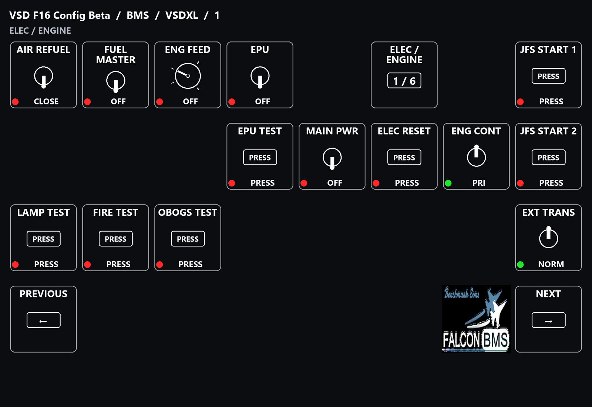

# VSD F16 Config Beta

rearanged icons to more closely match Block 50 layout

For DCS and Falcon BMS on the VSD XL_142 and N4 Pro.

[Download the beta](https://github.com/just-this-guy/vsd-f16-config-beta/releases/tag/v0.3.3-beta), extract the ZIP, and run **VSD F16 Config Beta.exe** from the top-level folder. Code → Download ZIP works too.

Close VSD Craft and the simulators first. Back up any layout you have edited.
Choose BMS, DCS, or both, select your panels, check prerequisites, review/edit
shortcuts, and apply.

DCS needs [DCS Interface by Charlie Tytler](https://github.com/enertial/streamdeck-dcs-interface)
and [DCS-ExportScript](https://github.com/s-d-a/DCS-ExportScripts); the installer includes links.

BMS needs keyboard focus. Its icons remember commands sent through VSD;
mouse/HOTAS changes can leave them out of sync until another successful press.
DCS uses cockpit feedback.

This is an informal, unsigned beta. Expect rough edges.

Third-party notices are in `licenses/`. No open-source license has been selected for the original code.
