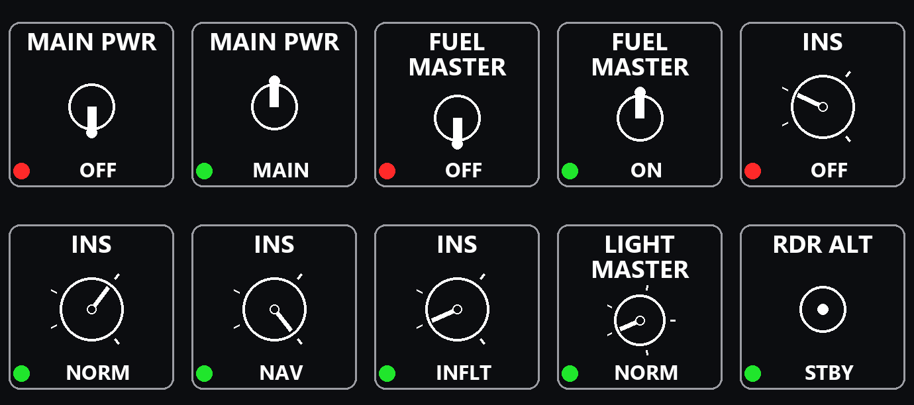
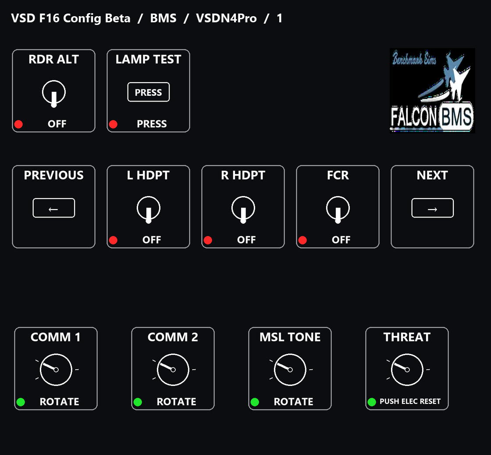

# VSD F16 Config Beta

F-16 cockpit controls for **DCS** and **Falcon BMS**, on **VSD XL_142** and **VSD N4 Pro**.

## Download and run

[Download the Windows installer and ZIPs](https://github.com/just-this-guy/vsd-f16-config-beta/releases/tag/v0.3.0-beta).

Run **VSD F16 Config Beta.exe**. Python is bundled. The portable ZIP adds instructions and runtime license notices; the source ZIP is also available.

1. Close VSD Craft and the selected simulators.
2. Confirm your software folders and select one or both panels.
3. Choose **BMS only**, **DCS only**, or **Both simulators**.
4. Check prerequisites. For DCS, install **DCS Interface by Charlie Tytler** and **DCS-ExportScript** separately; the installer provides download/help links and blocks missing prerequisites. BMS-only setup does not require DCS.
5. Choose your BMS keyfiles and open **Review / edit shortcuts**. Find conflicts, change keys/modifiers, and save/load mappings. Edited shortcuts update the simulator bindings and corresponding controls together.
6. Choose **Review choices**, then **Apply changes**, and choose whether to keep rollback backups.
7. Open VSD Craft and select the matching F-16 profiles. Restart DCS after changing its export scripts.

## Controls

- One button per persistent switch or selector; repeated presses toggle or cycle through its settings.
- Changing state graphics, larger bold top-center labels, and larger state captions.
- Bottom-left red/green indicators with twice the earlier diameter.
- Four profiles and 28 pages; physical encoder functions and momentary controls retained.
- Linked simulator switching for both panels, or independent/single-simulator setup.



The images below are renders from the packaged graphics, not live simulator captures.




## Feedback and limitations

**BMS:** images track commands made through VSD, not live cockpit telemetry. Starting a new flight or changing switches elsewhere can desynchronize them. BMS must have keyboard focus. A yellow warning triangle can mean a press was blocked because another window was active; bring the running BMS cockpit to the foreground and retry. Rejected presses do not change displayed state. Release extra held keyboard modifiers before pressing.

**DCS:** selector graphics follow fresh F-16 cockpit arguments. Gray / NO DATA means feedback is unavailable. Commands use the checked DCS-ExportScript listener port; dedicated F-16 telemetry uses loopback 26028. Existing export hooks remain chained. Native momentary controls still require DCS Interface.

Red means OFF (or a closed refueling door); green indicates an active named setting. Selectors without OFF use green for their named modes.

The installer supports updates to matching profiles, conflict review, selected BMS keyfiles, and rollback backups. It preserves unrelated keyboard and joystick/MFD assignments. It does not install a Windows service or startup task or automatically download prerequisites.

This is an **unsigned beta**. Isolated installer tests (19), offline runtime tests (16), standalone EXE startup, and the GUI/174-row binding editor were checked. Full physical-device and in-flight behavior still requires validation.

## Source and tests

See [Build.txt](Build.txt). With Python installed:

```powershell
python test_beta.py
python test_runtime.py
python build_beta.py --python "C:/path/to/python.exe"
```

Regenerating graphics additionally needs Pillow. Installing/running the distributed EXE does not require a separate Python installation.

## Credits

- [DCS Interface](https://github.com/enertial/streamdeck-dcs-interface) by Charlie Tytler; plugin ID `com.ctytler.dcs.sdPlugin`.
- [DCS-ExportScripts](https://github.com/s-d-a/DCS-ExportScripts).
- Simulator logos and third-party software remain the property of their respective owners. Runtime notices are in [licenses](licenses).

No open-source license has been selected for the original profile/application code. Do not commit local backups, installation reports, device serials, or personal keyfiles.
